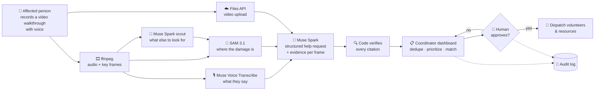
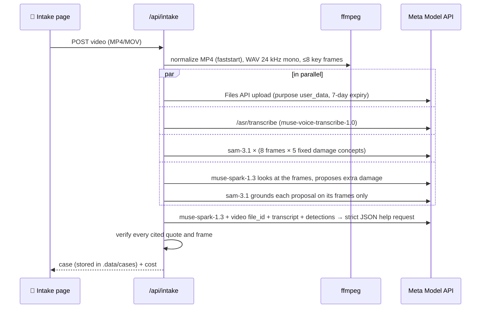
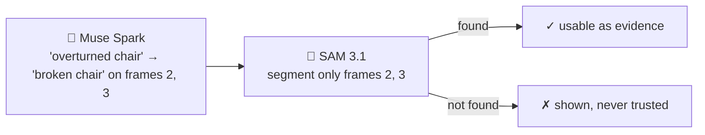
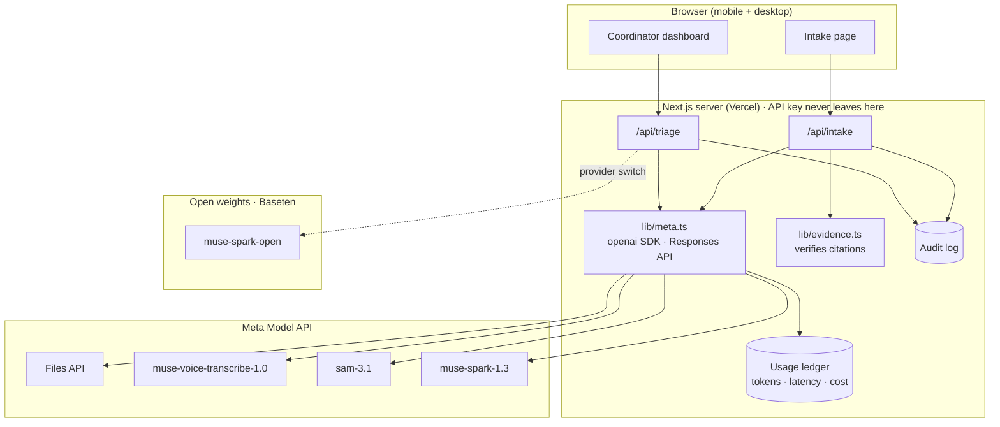
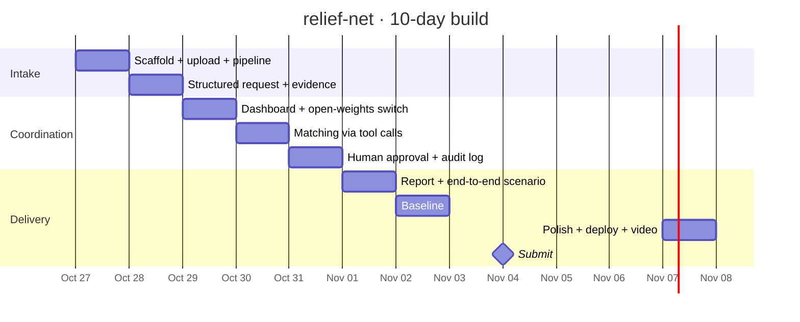

<div align="center">

# 🛟 relief-net

**AI coordination layer for community disaster response**

From a phone video of a damaged home to a prioritized, evidence-backed help request, with a human coordinator approving every dispatch.


</div>

---

## 💡 The problem

After a flood, fire or storm, help requests arrive as scattered calls, messages and photos. Volunteer coordinators spend hours reading, deduplicating and prioritizing them by hand, while the people who need help most wait.

**relief-net** turns each request into structured, evidence-backed data and helps one human coordinator triage many requests in minutes instead of hours.

## 🔄 How it works



## 🎥 Intake → verified help request (working)

A synthetic 19-second walkthrough becomes a prioritized help request in **under a minute for ≈ $0.17**. Every claim cites evidence, and the evidence is checked in code:


Damage masks from SAM 3.1 on the key frames:


<sub>🔴 crack · 🟤 mud · 🟠 debris · 🔵 broken window · 🟢 mold · 🟣🩷 damage proposed by Muse Spark. All images are synthetic, generated with Muse Image.</sub>



### 🔍 Verifiable by design

The model never gets the last word on facts. Each household fact, damage item and need cites a **transcript quote** or a **frame + damage label**, and code checks it:

| Evidence | Check | Rejected when |
|---|---|---|
| `“Two adults and one child live here.”` | quote appears in the transcript (case/punctuation-insensitive) | the model paraphrases or invents |
| `frame 2 · mud` | SAM 3.1 detected `mud` in frame 2 | wrong frame, or damage SAM never saw |

Unit tests (`npm test`) cover invented quotes, undetected damage, missing frames and empty citations.

### 🤖 Agentic grounding

SAM segments *objects* well and *textures* poorly: on a moldy wall `"mold"` finds nothing while `"black spots"` does. So relief-net combines a fixed list of damage prompts with a **scout**: Muse Spark looks at the numbered key frames, proposes up to 4 more kinds of damage as SAM-friendly noun phrases on specific frames, and SAM tries to locate each one.



On the test walkthrough Spark proposed 4 items; SAM located 2 (overturned chair, soiled sofa) and rejected 2 textures (standing water, peeling paint).

### 💰 Cost and time per case (measured)

| Step | Calls | Time | Cost |
|---|---:|---:|---:|
| ffmpeg prepare | – | 1.7 s | – |
| Files API upload | 1 | 4.3 s | – |
| Muse Voice Transcribe | 1 | 5.6 s | $0.001 |
| SAM 3.1, fixed concepts | 40 images | 10.2 s | $0.100 |
| Scout: Spark + SAM grounding | 1 + 8 images | 7.3 s | $0.030 |
| Muse Spark help request (≈ 6.7k in / 5.3k out tokens) | 1 | 25–38 s | $0.033 |
| **Total** | **51** | **≈ 47 s** | **≈ $0.17** |

Every model call is recorded with tokens or units, latency and cost (`.data/usage.jsonl`); `GET /api/usage` returns running totals.

## 🧩 Architecture



## 🤖 Meta models used

| Model | Role in relief-net |
|---|---|
| `muse-spark-1.3` | Structured help request (strict JSON schema, video input), scout that proposes what SAM should look for; next: deduplication, prioritization, tool calls to match volunteers/resources, draft insurance/aid report |
| `sam-3.1` | Segments visible damage on key frames as evidence, including damage proposed by Spark |
| `muse-voice-transcribe-1.0` | Transcribes the narrated walkthrough |
| Files API (`purpose: "user_data"`) | Video upload |
| `muse-image-1.0` | Generates the synthetic test scenes (no real photos are used) |
| `meta-models/muse-spark-open-1026` on Baseten | Open-weights option for the coordinator side (triage, dedupe, tool-call matching), so sensitive request data can stay on infrastructure the relief organization controls. Verified: tool calling, strict JSON schema, Responses API |

Only Standard models are used. The `*-contributor` variants are avoided so that data is not used for training.

## 🗺️ Roadmap

| Day | Milestone | Status |
|---|---|:---:|
| Oct 26 | Kickoff, API check, repo | ✅ |
| Oct 27 | Next.js scaffold, video upload, transcription + segmentation pipeline | ✅ |
| Oct 28 | Structured request with per-frame evidence · evidence verification · agentic grounding · cost ledger | ✅ |
| Oct 29 | Coordinator dashboard: list, dedupe, priority · provider switch Meta ↔ open weights (Baseten) | ⬜ |
| Oct 30 | Tool calls to match volunteers/resources, explained reasoning | ⬜ |
| Oct 31 | Human approval, audit log, safety rules | ⬜ |
| Nov 1 | Insurance/aid draft report, full synthetic end-to-end scenario | ⬜ |
| Nov 2 | Measurement vs manual baseline (15 requests), Meta API vs open weights | ⬜ |
| Nov 3 | Polish, Vercel deploy, demo video | ⬜ |
| Nov 4 | Submission | ⬜ |



## 🛡️ Safety by design

- 👤 **Human in the loop:** a coordinator approves every dispatch, and the AI only proposes.
- 🧾 **Audit log:** every AI suggestion and human decision is recorded.
- 🚨 **Emergencies go to 112**, and structural risk goes to professionals. relief-net does not give medical or structural advice.
- 🔐 **Server-side only:** the API key lives in the server environment and never reaches the browser.
- 🧪 **Synthetic data only:** no real people, companies or clients.

## 🚀 Getting started

```bash
npm install
cp .env.example .env              # paste your MODEL_API_KEY into .env (local only)
node scripts/check-meta-api.mjs   # lists your models and pings muse-spark-1.3
node scripts/make-fixture.mjs     # synthetic flood walkthrough → private/fixtures/intake-flood.mp4 (macOS)
npm run dev                       # http://localhost:3000
curl localhost:3000/api/health    # {"ok":true,"model":"muse-spark-1.3","reply":"OK",...}
open http://localhost:3000/intake # upload the walkthrough: help request + damage masks
npm run typecheck                 # generate Next route types, then tsc
npm test                          # evidence verification tests
curl localhost:3000/api/usage     # calls, tokens and estimated cost so far
```

## 📁 Repository layout

```
relief-net/
├── app/
│   ├── api/health/route.ts      # GET: minimal Muse Spark round trip
│   ├── api/intake/route.ts      # POST video → verified help request
│   ├── api/cases/[id]/request/  # re-draft the help request of a stored case
│   ├── api/usage/route.ts       # GET running usage and cost totals
│   ├── cases/[id]/page.tsx      # view a stored case
│   ├── intake/                  # intake page: upload, help request card, mask overlays
│   ├── layout.tsx
│   └── page.tsx                 # landing page
├── lib/
│   ├── meta.ts                  # server-only Meta Model API client (Responses API)
│   ├── media.ts                 # ffmpeg: MP4 faststart, WAV 24 kHz, key frames
│   ├── transcribe.ts            # Muse Voice Transcribe (/asr/transcribe)
│   ├── segment.ts               # SAM 3.1 damage concepts on frames
│   ├── scout.ts                 # Muse Spark proposes extra damage for SAM to ground
│   ├── request.ts               # Muse Spark structured help request (strict JSON schema)
│   ├── evidence.ts              # deterministic evidence checks (+ evidence.test.ts)
│   ├── usage.ts · pricing.ts    # per-call tokens, latency and cost ledger
│   ├── cases.ts                 # local case store (.data/cases)
│   └── intake.ts                # pipeline orchestration
├── docs/
│   ├── assets/                  # screenshots (synthetic data only)
│   ├── PLAN.md                  # 10-day build plan
│   └── RULES.md                 # hackathon rules summary
├── scripts/
│   ├── check-meta-api.mjs       # API key + model access check
│   └── make-fixture.mjs         # synthetic test video (Muse Image + say + ffmpeg)
├── .env.example                 # environment template (no secrets)
├── AGENTS.md                    # Next.js agent notes (maintained by next dev)
├── LICENSE                      # MIT
└── CLAUDE.md                    # project rules for the AI coding assistant
```

---

<div align="center">
<sub>Built from scratch during the Meta Global AI Developer Hackathon · Oct 27 – Nov 4, 2026</sub>
</div>
