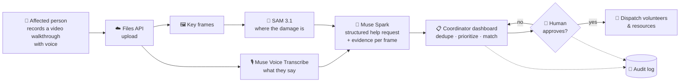
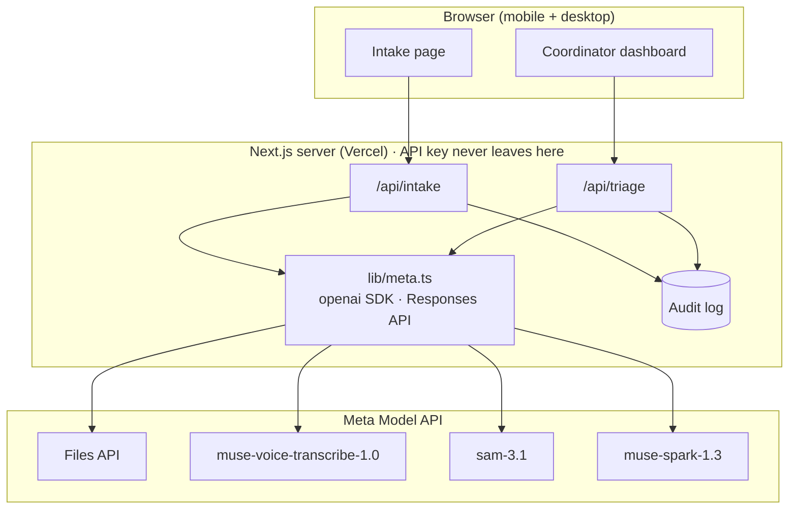
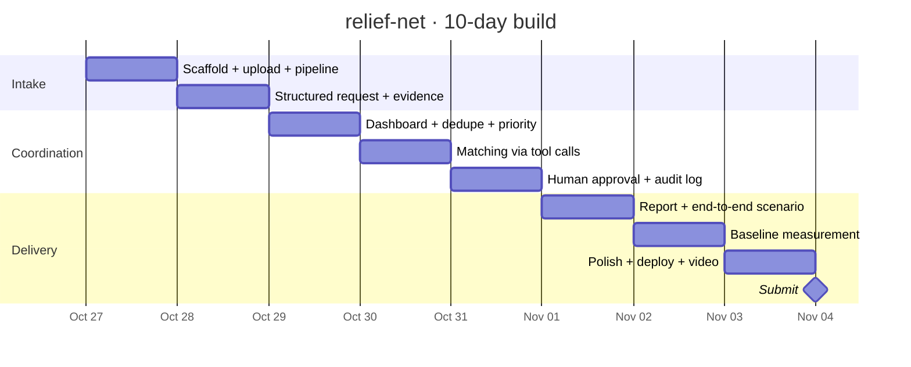
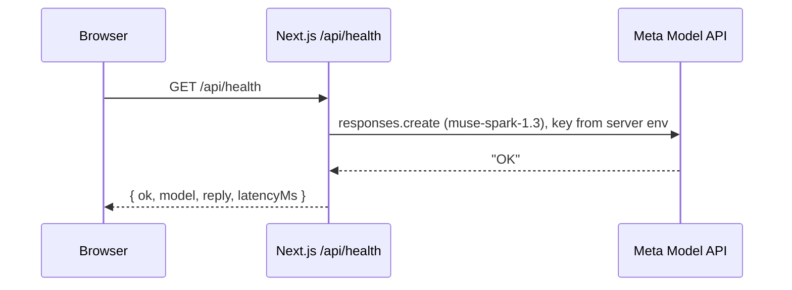

<div align="center">

# 🛟 relief-net

**AI coordination layer for community disaster response**

From a phone video of a damaged home to a prioritized, evidence-backed help request, with a human coordinator approving every dispatch.


</div>

---

## 💡 The problem

After a flood, fire or storm, help requests arrive as scattered calls, messages and photos. Volunteer coordinators spend hours reading, deduplicating and prioritizing them by hand, while the people who need help most wait.

**relief-net** turns each request into structured, evidence-backed data and helps one human coordinator triage many requests in minutes instead of hours.

## 🔄 How it works



## 🧩 Architecture



## 🤖 Meta models used

| Model | Role in relief-net |
|---|---|
| `muse-spark-1.3` | Structured help request, deduplication, prioritization, tool calls to match volunteers/resources, explained reasoning, draft insurance/aid report |
| `sam-3.1` | Segments visible damage on video frames as evidence |
| `muse-voice-transcribe-1.0` | Transcribes the narrated walkthrough |
| Files API (`purpose: "user_data"`) | Video upload |
| Muse Spark Open / Muse Glimmer *(stretch)* | Open-weights option via Baseten or Modal |

Only Standard models are used. The `*-contributor` variants are avoided so that data is not used for training.

## 🗺️ Roadmap

| Day | Milestone | Status |
|---|---|:---:|
| Oct 26 | Kickoff, API check, repo | ✅ |
| Oct 27 | Next.js scaffold, video upload, transcription + segmentation pipeline | 🟡 scaffold + Meta client done |
| Oct 28 | Structured request with per-frame evidence | ⬜ |
| Oct 29 | Coordinator dashboard: list, dedupe, priority | ⬜ |
| Oct 30 | Tool calls to match volunteers/resources, explained reasoning | ⬜ |
| Oct 31 | Human approval, audit log, safety rules | ⬜ |
| Nov 1 | Insurance/aid draft report, full synthetic end-to-end scenario | ⬜ |
| Nov 2 | Measurement vs manual baseline (15 requests), open-weights option | ⬜ |
| Nov 3 | Polish, Vercel deploy, demo video | ⬜ |
| Nov 4 | Submission | ⬜ |



## 🛡️ Safety by design

- 👤 **Human in the loop:** a coordinator approves every dispatch, and the AI only proposes.
- 🧾 **Audit log:** every AI suggestion and human decision is recorded.
- 🚨 **Emergencies go to 112**, and structural risk goes to professionals. relief-net does not give medical or structural advice.
- 🔐 **Server-side only:** the API key lives in the server environment and never reaches the browser.
- 🧪 **Synthetic data only:** no real people, companies or clients.

## 🚀 Getting started

```bash
npm install
cp .env.example .env              # paste your MODEL_API_KEY into .env (local only)
node scripts/check-meta-api.mjs   # lists your models and pings muse-spark-1.3
npm run dev                       # http://localhost:3000
curl localhost:3000/api/health    # {"ok":true,"model":"muse-spark-1.3","reply":"OK",...}
```



## 📁 Repository layout

```
relief-net/
├── app/
│   ├── api/health/route.ts      # GET: minimal Muse Spark round trip
│   ├── layout.tsx
│   └── page.tsx                 # landing page
├── lib/
│   └── meta.ts                  # server-only Meta Model API client (Responses API)
├── docs/
│   ├── PLAN.md                  # 10-day build plan
│   └── RULES.md                 # hackathon rules summary
├── scripts/
│   └── check-meta-api.mjs       # API key + model access check
├── .env.example                 # environment template (no secrets)
├── AGENTS.md                    # Next.js agent notes (maintained by next dev)
└── CLAUDE.md                    # project rules for the AI coding assistant
```

---

<div align="center">
<sub>Built from scratch during the Meta Global AI Developer Hackathon · Oct 27 – Nov 4, 2026</sub>
</div>
